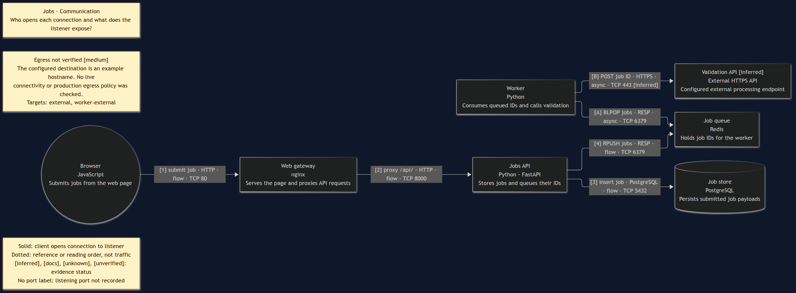

# Jobs · Project architecture

This source-backed fixture demonstrates a whole-project map, not a file dependency
graph. It contains representative source and deployment inputs; the example images
and external hostname are illustrative, not a runnable production distribution.

## Views of one model

| View | Question | Generated source |
|---|---|---|
| Overview | What are the principal components? | [overview.mmd](diagrams/overview.mmd) |
| Stack | Which technologies support each capability? | [stack.mmd](diagrams/stack.mmd) |
| Communication | Who opens connections, over which protocols and listening ports? | [communication.mmd](diagrams/communication.mmd) |
| Deployment | How do local and production resources implement the same logical services? | [deployment.mmd](diagrams/deployment.mmd) |



Rendered previews: [overview](diagrams/overview.png), [stack](diagrams/stack.png),
[deployment](diagrams/deployment.png). These are automatic Mermaid layouts.

Maintain `model.yaml`, `views/*.yaml`, and this guide. Regenerate `diagrams/*.mmd`;
direct Mermaid edits will be overwritten. No coordinate layout is required.

```bash
for view in overview stack communication deployment; do
  ./bin/noodle render examples/project-architecture --view "$view" --format mermaid \
    -o "examples/project-architecture/diagrams/$view.mmd"
done
```

Run from the repository root; output directories must already exist. Omitting `-o`
validates without writing. The generated Mermaid can be opened in a Mermaid viewer.

## Communication and source evidence

- The [browser code](source/frontend/app.js) submits `/api/jobs`. It runs in the
  browser, not inside an nginx server process. [nginx](deploy/nginx.conf) listens on
  TCP 80 and proxies to the API on TCP 8000. Local Compose maps host 8080 to nginx 80.
- The [FastAPI service](source/api/app.py) opens PostgreSQL connections and inserts
  payloads, then opens a Redis connection to enqueue job IDs. Database and Redis
  endpoints come from [Compose](deploy/compose.yaml), not merely dependency imports.
- The [worker](source/worker/worker.py) opens Redis connections and blocks on
  `BLPOP`. Redis does not initiate a connection to the worker. The worker then opens
  HTTPS connections to the configured validation URL.
- [Kubernetes workload intent](deploy/k8s.yaml) defines production resources.
  `matches` connects the logical API/worker to discovered workload IDs. The
  deployment view's `deploys` links are configuration references, not traffic.

`evidence` records file paths relative to this directory and classifications for
every element and relationship. `inferred` means intended communication derived
from client/configuration evidence, not observed traffic. Source citations are
retained in generated comments; important uncertainty is also visible on the map.

## Environments and unknowns

Overview and communication show **logical roles**, not one combined live environment.
Local and production are separate instances with separate endpoints. The deployment
map shows only the application deployment resources and their links to logical roles.
Production gateway, database and Redis provisioning are outside the supplied manifests.

`validation.example` is an example destination. HTTPS implies port 443, but neither
its existence nor production egress was verified. An annotation makes that limitation
visible. No secrets, live cluster state, or real traffic were collected.

## Updating the architecture

If the API changes technology or responsibility, update its source-backed `api`
element once, refresh the evidence, and regenerate all four views. They refer to
the same ID and display the new shared facts. For a changed Redis endpoint, inspect
the client and each environment's configuration before changing connection facts.

To upgrade an existing v1alpha1 system, run `noodle upgrade SOURCE_DIR NEW_DIR`.
The destination must not exist. Legacy facts initially receive unknown evidence;
investigate and replace it rather than manufacturing citations.
